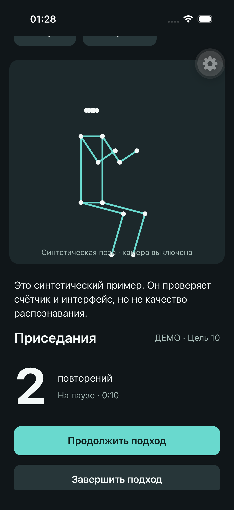
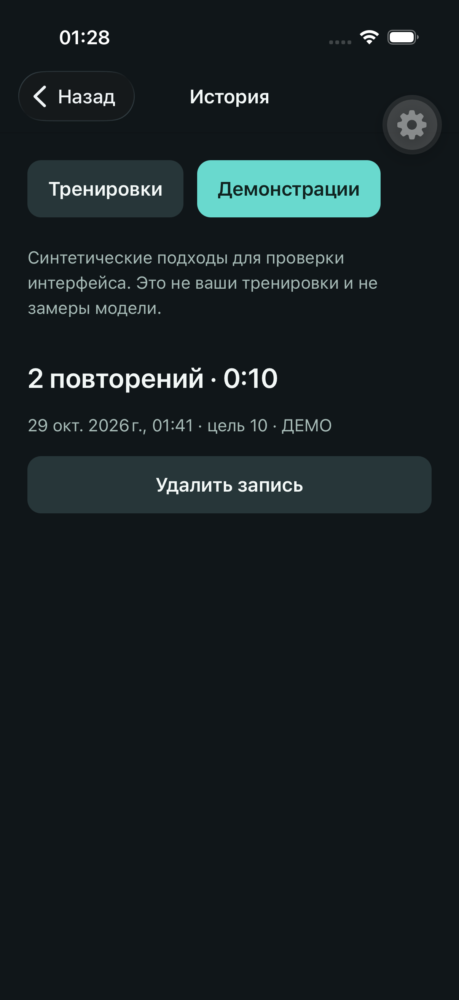

# Pose Coach

Экспериментальный счётчик приседаний на React Native: камера, локальная MoveNet,
скелет поверх изображения, подходы и история на устройстве. Видео не записывается
и не отправляется на сервер. Для просмотра без камеры есть **явно маркированная
синтетическая демонстрация** — это не проверка качества ML.

> Публичная версия готовится. iOS Simulator build, реальный warm-up модели,
> unit tests, typecheck и lint проверены локально. Демо-подход, сохранение истории
> и настройки цели после полного перезапуска проверены через интерфейс симулятора.
> Проверка живой камеры,
> совпадения оверлея с видео и счёта на физическом iPhone ещё не завершена.
> Неподтверждённых FPS и оценок точности нет.

## Сценарий

Разрешить камеру → поставить телефон → отсчёт → приседания → результат →
локальная история. Есть пауза, голосовой счёт и тактильный отклик. Конечный автомат
считает только устойчивую последовательность «стойка → низ → стойка»; потеря позы
или пауза сбрасывает незавершённое повторение, но сохраняет уже засчитанные.

Ошибка записи видна и допускает повтор. Синтетические подходы сохраняются отдельно
от реальных. Настройки не требуют аккаунта или сети.

## Реальные экраны

Снимки запущенного приложения на iPhone 17 Pro Simulator, iOS 26.3.1.
На них **синтетическая демонстрация**, не результат распознавания человека.
Кнопка с шестерёнкой поверх экрана принадлежит Expo development client.
Кадры сделаны 2026-10-29, до следующих UI-исправлений; это не снимки текущей сборки.

| Пауза демонстрационного подхода | История после перезапуска приложения |
|---|---|
|  |  |

## Стек и границы ответственности

| Задача | Инструмент |
|---|---|
| Приложение | Expo 57, React Native 0.86, React 19, Expo Router, TypeScript |
| Камера и отдельный runtime | VisionCamera 5, Worklets, Nitro Modules |
| Подготовка кадра и модель | VisionCamera Resizer, react-native-fast-tflite, MoveNet Lightning |
| Скелет | Skia + Reanimated shared values |
| UI-состояние подхода | Zustand; никаких кадровых буферов в store |
| Постоянные данные | expo-sqlite + Drizzle; MMKV для настроек |
| Проверки | node:test, настоящая SQLite в host-тестах, ESLint, tsc, GitHub Actions |

Структура feature-oriented: тонкие маршруты в `apps/mobile/app`, сценарии в
`src/features`, сущность тренировки в `src/entities/workout`, общий UI в
`src/shared`. Это не заявление о полной строгой FSD-изоляции: связи между текущими
feature-модулями явные. Сервер, MobX и TanStack Query в этой версии **не используются**.

## Симулятор

Проверенное окружение: Node **26.4.0**, pnpm **11.12.0**, Xcode **26.3**,
iOS Simulator **26.3.1**, Apple Silicon. Нужны CocoaPods и платформа iOS.
Это development build: **Expo Go не подходит** из-за нативных модулей.

```bash
pnpm install --frozen-lockfile
pnpm --filter mobile exec expo run:ios
# После первой сборки сервер можно запускать из корня:
pnpm start
```

В приложении: «Посмотреть демонстрацию» → «Начать подход» → «Завершить подход».
Результаты находятся в «История» → «Демонстрации». Отсутствие физической камеры
в симуляторе ожидаемо.

## iPhone

1. Если `ios/` ещё нет: `pnpm --filter mobile exec expo prebuild --platform ios`.
   Открыть `apps/mobile/ios/posecoach.xcworkspace` в Xcode.
2. У target `posecoach` выбрать свою Team в Signing & Capabilities, включить
   Automatically manage signing, выбрать подключённый iPhone и нажать Run.
3. Разрешить Developer Mode / доверие профилю на телефоне, если iOS запросит.
4. Запустить `pnpm start:device`. Телефон и Mac должны видеть друг друга в локальной
   сети; разрешить Local Network при запросе. Открыть адрес Metro в dev client.

Если порт `8081` занят другим проектом, не останавливайте его вслепую:
`pnpm start:device --port 8082` поднимет отдельный сервер. В dev client укажите
LAN-адрес Mac и тот же порт, а не `localhost` телефона. Наличие работающего Metro
само по себе не означает, что он обслуживает нужный проект.

Адрес `http://<LAN-IP-Mac>:8082` вводится **в установленном Pose Coach / Expo
development client**, не в Safari. Для проверки сети в Safari откройте именно
`http://<LAN-IP-Mac>:8082/status`: ожидается текст `packager-status:running`.
Адрес без `/status` в браузере может открыть веб-версию, которая здесь не
поддерживается; её ошибка не доказывает недоступность нативного Metro-сервера.

Нативный проект генерируется и не хранится в Git. После prebuild и обновления
нативных зависимостей проверяйте локальные настройки подписи Xcode. Изменение
TypeScript обычно не требует пересборки нативного приложения.

## Проверки

```bash
pnpm test
pnpm typecheck
pnpm lint
pnpm --filter mobile exec expo export --platform ios --output-dir /tmp/pose-coach-export
```

CI повторяет проверки с frozen lockfile. JS-экспорт не является native build.
Тест межпоточных очередей исполняет настоящий hook с заменой нативных API на
контролируемые очереди: он ловит логические регрессии, но не доказывает работу GPU,
сериализации worklets или камеры. Физическая проверка — отдельный этап.
Отдельная boundary-регрессия проверяет JavaScript-сериализацию и распаковку после
Expo Babel-преобразования; её нативные границы также заменены. Точное покрытие
и результаты описаны в [журнале проверок](docs/TESTING.md).

## Путь данных

```text
Камера → Worker: resize/rotate/contain → TFLite → собственная копия 17 точек
                                                 ↓
                     UI runtime: координаты/скелет + окно метрик
                                                 ↓
                  JS: только угол/видимость → автомат подхода → Zustand
                                                 ↓ завершение
                                          SQLite / Drizzle
```

GPU-буфер жив до `runSync`, затем освобождается; кадр освобождается в `finally`.
Поколение защищает от запоздалых ответов после pause/retry/unmount. Устаревшая
поза очищается. Обработка ограничена 15 Гц, HUD — 4 Гц: это **лимиты**, а не
измеренная производительность. Диагностика показывает реально собранные avg/p95
времени `runSync` и частоту обработанных кадров.

## Ограничения

Один человек, одно упражнение, портретная ориентация. Угол колена — двумерная
эвристика, не оценка правильности или безопасности техники. Нужны хорошее освещение,
видимые суставы и подходящий ракурс. При боли или дискомфорте остановитесь.
Android и web пока не прошли приёмку. Нет аккаунтов, синхронизации и восстановления
истории после удаления приложения. Пороговые значения требуют проверки на людях
с разным телосложением; это исследовательский проект, не медицинское устройство.

## Лицензии

Код — [MIT](LICENSE). Модель MoveNet — отдельная Apache-2.0;
[источник, SHA-256 и лицензия модели](apps/mobile/assets/models/README.md).
Зависимости сохраняют собственные лицензии. Решения — [архитектура](docs/ARCHITECTURE.md),
визуальные правила — [DESIGN.md](DESIGN.md), измерения — [BENCH.md](BENCH.md).

Иконки и splash пока сохранены из официального `expo-template-default`, не являются
собственным брендингом проекта. Все семь PNG, SVG и конфигурация Icon Composer
побайтово совпали по Git blob SHA-1 с
[upstream-ресурсами Expo](https://github.com/expo/expo/tree/96069ceb532ac43894f26fa393623daae850835c/templates/expo-template-default/assets).
В [метаданных этого шаблона](https://github.com/expo/expo/blob/96069ceb532ac43894f26fa393623daae850835c/templates/expo-template-default/package.json)
указана лицензия `0BSD`. MIT проекта не подменяет условия сторонних материалов.
Снимки выше созданы из работающего Pose Coach 2026-10-29, без ретуши и подмены данных.
Привязка источников и условий к каждому файлу — [реестр материалов](docs/ASSETS.md).
